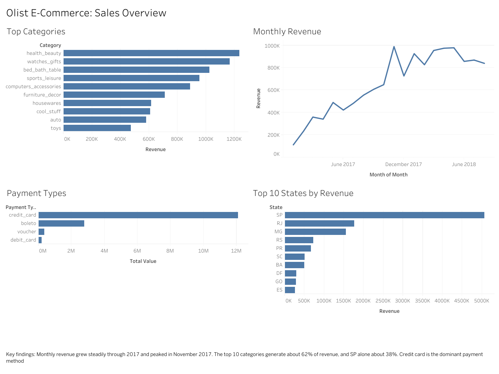
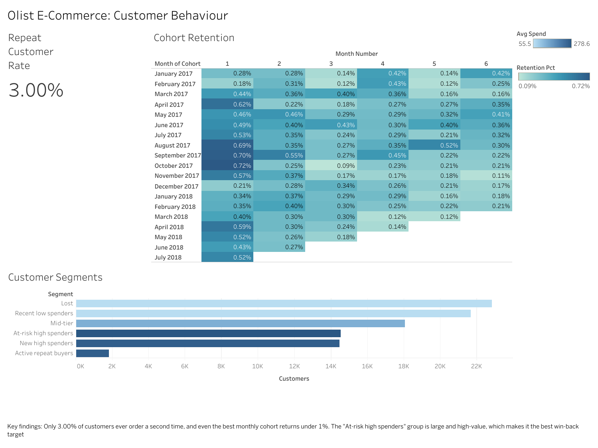
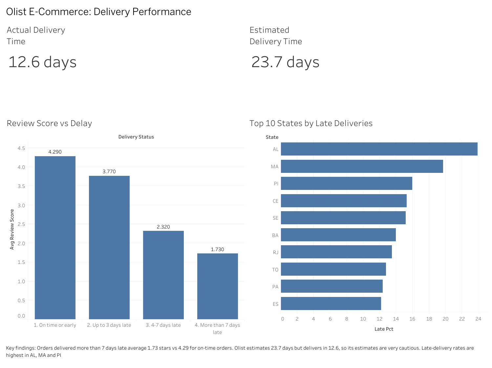

# Olist E-Commerce Sales Analysis

End-to-end analysis of about 100K Brazilian e-commerce orders (2016-2018). I wrote 10 SQL queries in PostgreSQL to answer business questions about sales, customers and delivery, then built a 3-page interactive dashboard in Tableau Public.

**Live dashboard:** [Olist E-Commerce Sales Analysis on Tableau Public](https://public.tableau.com/app/profile/abhishek.p4718/viz/OlistE-CommerceSalesAnalysis_17951655665390/Overview)

## Dashboard preview





## Business questions

| # | Question | Query |
|---|----------|-------|
| 1 | How has monthly revenue changed over time? | `sql/01_monthly_revenue.sql` |
| 2 | Which product categories earn the most? | `sql/02_top_categories.sql` |
| 3 | Which states drive revenue? | `sql/03_revenue_by_state.sql` |
| 4 | How long does delivery take vs. the estimate? | `sql/04_avg_delivery_time.sql` |
| 5 | Which states have the most late deliveries? | `sql/05_late_deliveries_by_state.sql` |
| 6 | How do delays affect review scores? | `sql/06_review_score_vs_delay.sql` |
| 7 | What share of customers buy more than once? | `sql/07_repeat_customer_rate.sql` |
| 8 | How do customers pay? | `sql/08_payment_types.sql` |
| 9 | Which customer segments exist (RFM)? | `sql/09_rfm_segments.sql` |
| 10 | Do customers come back after their first order (cohorts)? | `sql/10_cohort_retention.sql` |

## Key findings

### Sales
- Delivered-order revenue totals about **R$13.2M**. Monthly revenue grew steadily through 2017, peaked in **November 2017** at close to R$1M, then stayed between roughly R$0.8M and R$1.0M in 2018.
- The **top 10 categories generate about 62% of revenue**. `health_beauty`, `watches_gifts` and `bed_bath_table` lead.
- **Sao Paulo (SP) alone brings in over a third of revenue**, and SP, RJ and MG together account for roughly 60%.
- **Credit card is the dominant payment method**, at about three quarters of payment value. Boleto (a Brazilian bank slip) is second.

### Customers
- Only **3.00% of customers ever place a second order**.
- No monthly cohort gets more than **0.72%** of its customers back in any of the first six months after their first order. Growth depends almost entirely on acquiring new customers.
- RFM segmentation shows **Lost** as the largest segment. **At-risk high spenders** (roughly 14K customers) are a large, high-value group and the best win-back target. Only about 2K customers are active repeat buyers.

### Delivery
- Orders arrive in **12.6 days on average**, against an estimate of **23.7 days**, so Olist's estimates are very cautious.
- Delays hurt reviews badly. Average review score falls from **4.29** (on time or early) to **3.77** (up to 3 days late), **2.32** (4-7 days late) and **1.73** (more than 7 days late).
- Late-delivery rates are highest in AL (about 24%), MA and PI. RJ, the second-biggest revenue state, is also in the top 10 for late deliveries.

## Recommendations
1. **Fix delivery reliability first.** Late delivery is the strongest driver of low review scores, and the worst late rates are concentrated in a handful of states.
2. **Invest in retention.** With under 1% of a cohort returning in a month, a win-back campaign for at-risk high spenders and a follow-up after the first order are the clearest opportunities.
3. **Test tighter delivery estimates.** Actual delivery is about 11 days faster than the estimate. More accurate estimates could set better expectations, and this could be validated with an A/B test.

## Method notes
- Only orders with status `delivered` are counted.
- Revenue is `SUM(price)` and excludes freight. Payment totals include freight and installments, so they are higher than revenue.
- Customers are identified by `customer_unique_id`, because Olist assigns a new `customer_id` to every order.
- RFM uses `NTILE(5)` for recency and monetary value. Frequency is used directly because most customers ordered once. The segment thresholds are my own choices.
- The monthly trend chart starts in January 2017, because 2016 has only a handful of orders.
- Cohort retention is the percentage of customers whose first delivered order fell in a given month who ordered again N months later (shown for months 1-6).

## Tools
PostgreSQL, pgAdmin, SQL (joins, CTEs, window functions such as `NTILE`, `FIRST_VALUE` and `SUM() OVER`), Tableau Public, Git and GitHub.

## Repository structure
```
sql/         10 analysis queries
data/        query results exported as CSV (used by the dashboard)
dashboard/   Tableau workbook
images/      dashboard screenshots
```

## Dataset
[Brazilian E-Commerce Public Dataset by Olist](https://www.kaggle.com/datasets/olistbr/brazilian-ecommerce) on Kaggle.

Built by Abhishek P.
